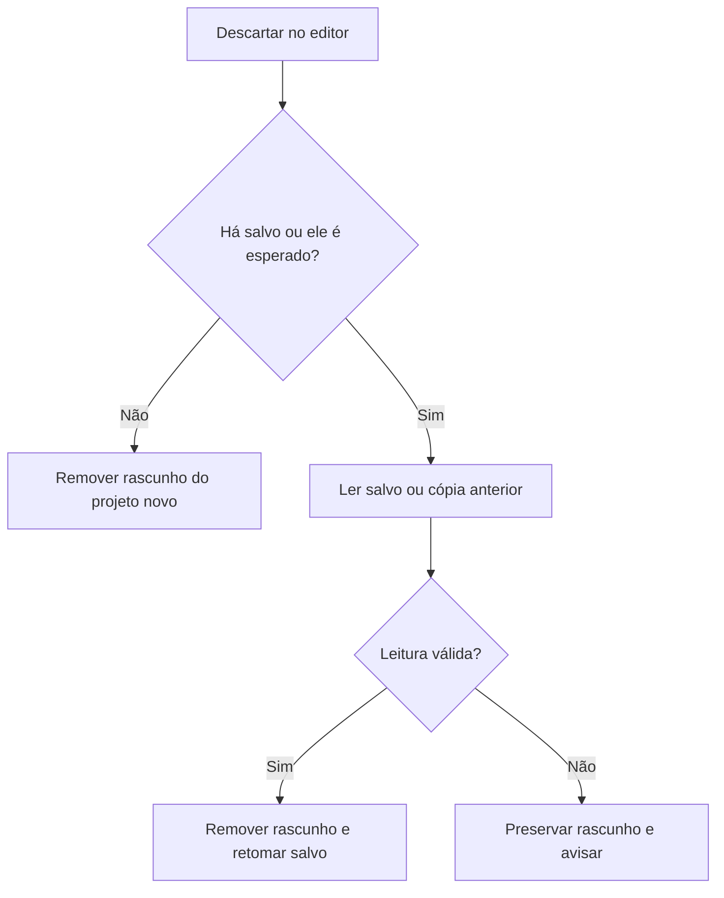

# Revisão Android 0.1.1

**Data:** 28/11/2026. **Versão:** `0.1.1-dev`, código `4`, pacote `br.com.agv.touch.dev`.

A revisão melhora a construção em telas estreitas ou baixas, corrige o enquadramento 3D e protege a recuperação e transferência de projetos. O escopo continua sendo o MVP nativo de blocos, missões e projetos locais. Câmera do dispositivo, realidade aumentada, interação corporal e VR não estão implementados.

## Construtor e acessibilidade

Os controles foram reorganizados para liberar espaço à cena e manter confirmação, materiais e ferramentas acessíveis. No mesmo emulador configurado em **1600 × 720 px, densidade 280**, a altura da área 3D passou de **184 para 568 px**: **3,09 vezes a altura anterior**, sem afirmar a mesma proporção de ganho de área. A grade e a torre-guia ficaram visíveis. [Medição](evidence/review-0.1.1/code4-short-landscape-metrics.json) e [captura](evidence/review-0.1.1/code4-mission-short-landscape.png).

O enquadramento considera a proporção do viewport, o chão e a altura da construção ou missão. Órbita e edição mantêm a referência estável; o comando **Enquadrar construção** recalcula a vista. Abrir outro projeto reinicia a câmera.

O ensaio com largura de **360 dp e fonte a 150%** revelou quebra de “Colocar bloco”. Na candidata corrigida e verificada, a confirmação mede **336 dp de largura e 50,5 dp de altura**, e Desfazer/Refazer têm **164 dp de largura cada**. [Medições da correção](evidence/review-0.1.1/code4b-phone-360dp-font150-metrics.json).

Na interação nativa, selecionar Madeira em `(0,0,0)` manteve zero blocos na prévia; confirmar criou um; desfazer voltou a zero; refazer restaurou um. A rotação preservou bloco, material e histórico de desfazer, e o feedback da edição foi exibido.

## Integridade dos projetos

Descartar uma recuperação agora exige carregar primeiro o salvo ou um backup válido. Se ambos estiverem corrompidos, o rascunho é preservado. A proteção vale tanto depois de recuperar quanto no aviso inicial.

A atualização com `install -r` do código 3 para a primeira candidata de código 4 preservou os hashes de um salvo sintético com um bloco e de um rascunho com dois. Pela interface, recuperar mostrou dois blocos; descartar retomou o salvo com um. Essa evidência identifica seu APK intermediário e não certifica automaticamente artefatos posteriores. [Preservação](evidence/review-0.1.1/code4-update-preservation.json) e [salvo restaurado](evidence/review-0.1.1/code4-restored-one.png).

Importação/exportação usam um worker retido durante rotação. UTF-8 inválido é rejeitado; cada importação recebe nova identidade. Cancelar antes do commit impede a gravação; durante o commit, o app aguarda sua conclusão. Resultados têm token de sessão para preservar outra edição. Exportação só confirma depois de gravar e fechar o destino; cancelamento ou falha pode deixar arquivo parcial. [Contrato completo](DOMAIN_CONTRACT.md).

## Verificações concluídas

Build e lint locais passaram, com **zero erros e 22 avisos**. A suíte de host passou com **36 cenários/239 operações**, **seis vetores de picking**, **33 asserções de transferência/recuperação** e **5.376 cantos projetados** no contrato de câmera. Streams simulados verificam cancelamento, falha no fechamento e entrega do resultado após troca de listener; não exercem um provedor SAF real.

O [CI Chrome 46144831502](https://github.com/gb-eli/touch/actions/runs/46144831502), no commit `891418b`, aprovou o protótipo: em **844 × 390**, palco de **554 × 314 px**, cinco ferramentas visíveis e missão concluída em **5/5**. Não houve erros JavaScript/console nem requisições externas. Essa validação corresponde ao HTML; a correção posterior do `BuilderScreen` Android foi compilada e conferida localmente. [Relatório do protótipo](../app-design/evidence/review-0.1.1/prototype-qa.json).

## Identificação do APK

A candidata `code4c` inclui a adaptação de fonte e a correção do seletor, além das melhorias de dados e enquadramento. Sua [verificação estática](evidence/review-0.1.1/apk-verification.json) registra identidade, assinatura, alinhamento e ausência de permissões.

- SHA-256 do APK: `392cceaf1f3a0672b28d29e4d0da5654562f74b696181a3b8be555200e96d782`.
- Tamanho: **118.899 bytes**.
- Certificado preservado: `a9154ab40c8744eab6d110cd1371686a85ed394ed9a35bf876a30becdf5eaf0a`.

## Validação nativa concluída

O seletor Downloads do API 28 desabilitava `.json` com o filtro MIME anterior, enquanto o mesmo conteúdo em `.txt` era selecionável. Remover `EXTRA_MIME_TYPES` permitiu selecionar o mesmo `.json`, mantendo a validação estrita no app. O MIME exato não foi obtido: o provedor recusou a consulta pelo shell, e suas permissões foram respeitadas.

No APK `code4c`, o arquivo da ponte foi importado pelo seletor nativo com cinco blocos, missão 5/5, novo UUID e salvamento local. O projeto anterior manteve seu hash. **Ver resultado** abriu a conclusão com a ponte e os três comandos visíveis.

A importação de UTF-8 inválido mostrou erro explícito e manteve os hashes dos dois projetos existentes. Na exportação, o aparelho foi girado enquanto o seletor estava aberto; o arquivo final ficou byte a byte idêntico ao projeto salvo, com os cinco blocos e metadados. O [relatório nativo](evidence/review-0.1.1/native-qa.json) identifica a candidata e as evidências de cada ensaio.

O buffer de crash coletado estava vazio, e o log examinado não continha FATAL/ANR do app. A rotação com o seletor aberto não equivale a testar toda a duração de um stream lento; a cobertura de cancelamento controlado continua pertencendo aos testes de host.

Ao trocar configurações do emulador, apareceu um aviso do **SystemUI**. O registro pertence ao ambiente de emulação; não foi atribuído a uma falha do app.

Instalação, multitoque, alcance, legibilidade a distância e desempenho no **Galaxy S25 Ultra** e na **Samsung WA86F** continuam sujeitos a testes físicos. As evidências Android estão em [review-0.1.1](evidence/review-0.1.1/) e o [roteiro de aceite](ACCEPTANCE.md) orienta as próximas verificações.
